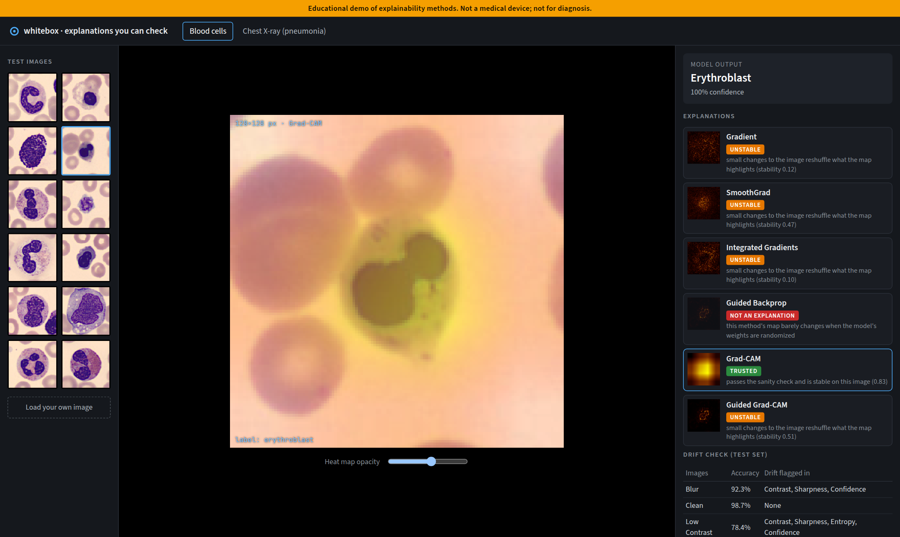
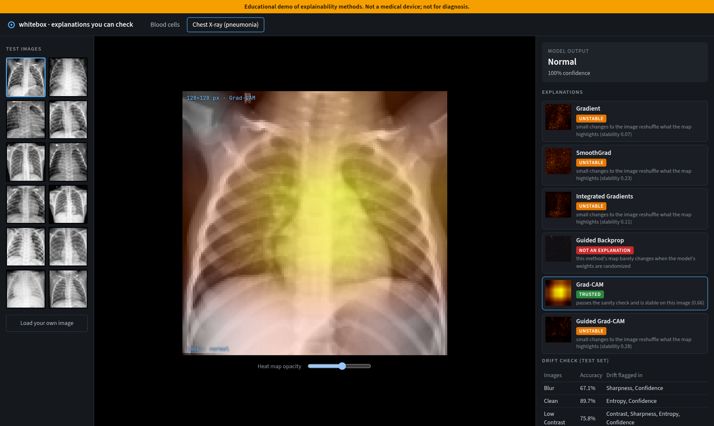

# whitebox-medmnist

**A medical image classifier that tells you whether its own explanation can be trusted.** Next to every prediction it
shows six heat maps, and each one carries a badge:

- **trusted:** the method passed the sanity check and its map is stable on this image;
- **unstable:** the method passed, but small changes to the image reshuffle what it highlights;
- **not an explanation:** the method's map barely changes when the model's weights are randomized.

> Educational demo of explainability methods. **Not a medical device; not for diagnosis.**



## Two papers, one question

**MedMNIST v2** (Yang et al., *Scientific Data* 2023) is a benchmark of small, standardized medical images with
reference results for ResNet-18. I reproduced it on two of its datasets.

**Sanity Checks for Saliency Maps** (Adebayo et al., NeurIPS 2018) showed that some popular explanation methods produce
nearly the same heat map for a trained model and for one with random weights. They draw the image, not the model. I ran
their tests on the medical models.

**My addition** comes from my master's thesis on GNN explanations: passing the sanity check is not enough. An
explanation should also be **stable**: if an imperceptible amount of noise changes what it highlights, it can't be
what the model "looked at". The viewer only calls a map *trusted* when both hold.

## What came out

**MedMNIST reproduces.** ResNet-18 at 28×28, with the paper's recipe (100 epochs, Adam, learning-rate decay at 50 and
75):

| test set | AUC paper | AUC here | ACC paper | ACC here |
|---|---:|---:|---:|---:|
| BloodMNIST (8 cell types) | 0.998 | **0.997** | 0.958 | **0.957** |
| PneumoniaMNIST (chest X-ray) | 0.944 | **0.943** | 0.854 | 0.784 |

At 128×128 with an ImageNet-pretrained ResNet-18, used for the explanations: BloodMNIST AUC 0.999 / ACC 0.987,
PneumoniaMNIST AUC 0.974 / ACC 0.897. ([results/benchmark](results/benchmark))

PneumoniaMNIST's accuracy is the one number that doesn't match. AUC (threshold-free) does, so the model separates the
classes as well as the paper's. The drift test below shows why accuracy at the default threshold doesn't: the test
set doesn't look like the validation set.

**The sanity check reproduces.** Similarity (rank correlation) between the trained model's map and the map after
randomizing the top block (`fc` + `layer4`), averaged over 50 test images; below 0.5 passes
([results/sanity](results/sanity)):

| method | PneumoniaMNIST | BloodMNIST | sanity | stability (top-5% overlap) |
|---|---:|---:|:---:|---:|
| Gradient | 0.21 | 0.22 | pass | 0.05 / 0.09 |
| SmoothGrad | 0.08 | 0.13 | pass | 0.17 / 0.47 |
| Integrated Gradients | 0.30 | 0.24 | pass | 0.07 / 0.11 |
| **Guided Backprop** | **0.91** | **0.93** | **fail** | 0.18 / 0.47 |
| Grad-CAM | 0.04 | −0.19 | pass | **0.44 / 0.87** |
| Guided Grad-CAM | 0.21 | 0.12 | pass | 0.20 / 0.50 |

- **Guided Backprop fails, as in the paper.** With the last layer randomized its map is still 100% the same, and 91–93%
  with the whole top block randomized. It survives on medical images just as it did on ImageNet.
- **Guided Grad-CAM passes here.** The paper found it invariant too. In these models its Grad-CAM half moves enough to
  change the product. That's a difference from the paper, and I report it as one.
- **Passing isn't the same as being stable.** Add noise with a standard deviation of 0.02 (invisible) and the 5% of
  pixels Gradient highlights overlap only 5–9% with the previous ones. Integrated Gradients does barely better.
  Grad-CAM, coarse as it is, keeps 44% on X-rays and 87% on blood cells. **Under the trusted rule (pass and ≥ 0.6
  stable), Grad-CAM on blood cells is the only method that usually earns the badge;** the viewer checks it per image.

**Drift is caught, and it means something.** Evidently compares per-image signals (brightness, contrast, sharpness,
entropy, model confidence) of the test set against validation, clean and corrupted ([results/drift](results/drift)):

| PneumoniaMNIST | accuracy | drift flagged in |
|---|---:|---|
| clean test set | 0.897 | entropy, confidence |
| + noise | 0.635 | contrast, sharpness, entropy, confidence |
| + blur | 0.671 | sharpness, confidence |
| + low contrast | 0.758 | contrast, sharpness, entropy, confidence |

Each corruption trips the signal it should, and every alarm comes with an accuracy drop. On BloodMNIST the clean test
set shows no drift at all (accuracy 0.987); on PneumoniaMNIST even the clean test set drifts from validation, which is
the accuracy gap above.

## How it works

- **Training** (`scripts/train.py`): ResNet-18, CIFAR-style at 28 px (the benchmark's variant), torchvision's
  pretrained one at 128 px.
- **Six saliency methods** through [Captum](https://captum.ai) (`application/saliency.py`).
- **Sanity checks** (`scripts/sanity.py`): cascading randomization (fc, layer4, … conv1) and one block at a time,
  compared with the four measures of the paper: Spearman with and without absolute values, SSIM, HOG correlation.
  Per-image stability on 5 noisy copies.
- **The trust rule** lives in one place, plain Python, with its thresholds stated up front
  ([`domain/trust.py`](src/whitebox_medmnist/domain/trust.py)).
- **Drift** (`scripts/drift.py`): image signals plus the model's confidence, with Evidently's per-column tests, against
  three corruptions.
- **API** (FastAPI) and an **Angular viewer** in the style of a clinical image viewer: the image on black, the heat map
  overlay with adjustable opacity, every method with its badge, and the not-for-diagnosis notice always on top.
- **Jenkins:** lint, tests, the web build, an optional GPU stage that retrains and re-runs the sanity checks, and a
  **quality gate** that fails the build if the test AUC drops or if a method the viewer may call trusted stops passing
  the sanity check. Runs are logged to MLflow.



## Run it

```bash
uv sync --group mlops
./run.sh benchmark   # 28 px, the paper's recipe (a few minutes on a GPU)
./run.sh train       # 128 px models for the explanations
./run.sh sanity      # sanity checks and stability (also runs on CPU)
./run.sh drift
./run.sh api         # http://localhost:8000
./run.sh web         # http://localhost:4200
./run.sh test
```

The MedMNIST files are downloaded by the official `medmnist` package on first use.

## What didn't work

- **Explaining 50 images at once.** Integrated Gradients runs 32 forward and backward passes per image; on an 8 GB GPU
  that ran out of memory. Explaining in chunks of five fixed it.
- **Grad-CAM's sanity numbers came out as NaN.** Grad-CAM keeps only positive evidence, so some maps are all zeros and
  a rank correlation with a constant map is undefined. Those images are now left out of the averages and counted.
- **My first drift report flagged nothing**, not even under noise that cost 26 points of accuracy. I was reading the
  wrong field of Evidently's output and treating every test as a p-value; with many images Evidently uses a distance
  instead, where drift means *above* the threshold.
- **The heat map overlay was invisible on blood smears.** A screen blend disappears on light backgrounds; the API now
  sends a coloured map with transparency.

## Credits and licenses

- MedMNIST v2: Yang et al., *MedMNIST v2: A large-scale lightweight benchmark for 2D and 3D biomedical image
  classification*, Scientific Data 10, 41 (2023). CC BY 4.0. PneumoniaMNIST is from Kermany et al., Cell 2018;
  BloodMNIST from Acevedo et al., Data in Brief 2020. Not redistributed here.
- Adebayo, Gilmer, Muelly, Goodfellow, Hardt & Kim, *Sanity Checks for Saliency Maps*, NeurIPS 2018.
- Code: MIT.
